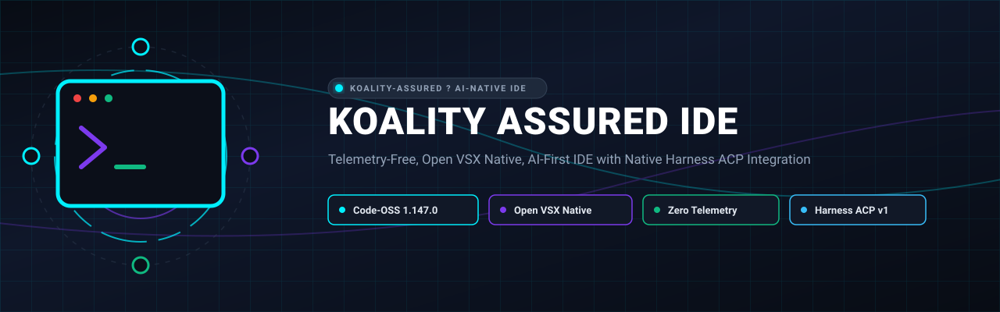
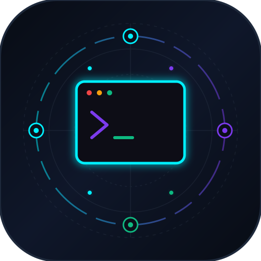

<div align="center">



# Koality Assured IDE

<p align="center">
  
</p>

**Telemetry-Free, Open VSX Native, AI-First IDE with Native Harness ACP Integration**

[](https://github.com/Koality-Assured/koality-assured-ide/actions/workflows/ci.yml)
[](LICENSE)
[](https://nodejs.org/)
[](https://www.typescriptlang.org/)
[](#architecture)
[](https://conventionalcommits.org)

</div>

---

## Overview

`koality-assured-ide` is a telemetry-free, open-source Integrated Development Environment built on pinned `Code-OSS` release tags and wired to the Koality Assured agent harness via the **Agent Client Protocol (ACP v1)**.

Rather than maintaining a monolithic fork of `microsoft/vscode`, this repository follows a **Patch-and-Overlay** layout: it tracks branding assets, `product.json`, minimal differential patches, build scripts, and built-in harness integration extensions, fetching upstream `Code-OSS` source tags at build time.

## Architecture

- **Upstream Base:** Pinned `Code-OSS` stable release tags (no unpinned `main` tracking).
- **Zero Telemetry:** `product.json` sets `"enableTelemetry": false` and strips proprietary telemetry endpoints; differential patches replace `ITelemetryService` with a no-op implementation.
- **Open VSX Registry:** Extension discovery and installation route exclusively to the Eclipse Foundation's [Open VSX Registry](https://open-vsx.org/vscode/gallery).
- **Decoupled Agent Control Plane:** Agent execution, Git worktree isolation, SQLite session sync, and OS Keyring secret injection live in the external Harness daemon (`harness-cli` / ACP v1), keeping core `Code-OSS` patches minimal.

## Repository Structure

```text
koality-assured-ide/
├── .github/workflows/ci.yml         # ESLint, markdownlint, tsc, tests, Gitleaks, OWASP Noir
├── assets/
│   ├── icons/                       # Replacement PNG/ICO app icons (no MS trademarks)
│   ├── koality-assured-ide-banner.svg
│   └── koality-assured-ide-logo.svg
├── build/
│   ├── scripts/prepare-source.ts    # Headless Code-OSS tag clone, patch, and overlay runner
│   └── upstream.json                # Pinned upstream Code-OSS release tag (1.147.0)
├── patches/
│   ├── branding.patch               # Replaces fallback Code-OSS/VS Code branding
│   └── disable-telemetry.patch      # Neutralizes ITelemetryService with NullTelemetryService
├── tests/
│   ├── prepare-source.test.mjs      # Patch pipeline & config assertions
│   └── product.test.mjs             # Product configuration & Open VSX assertions
├── .editorconfig
├── .markdownlint-cli2.jsonc
├── CONTRIBUTING.md
├── LICENSE                          # MIT License
├── SECURITY.md
├── eslint.config.mjs
├── package.json
├── product.json
└── tsconfig.json
```

## Quickstart

```bash
git clone https://github.com/Koality-Assured/koality-assured-ide.git
cd koality-assured-ide
npm ci
npm run lint
npm run lint:md
npm run typecheck
npm test

# Fetch pinned Code-OSS tag, apply patches, and overlay product.json + icons
npm run prepare-source
```

## Security & Telemetry

- All upstream telemetry and Microsoft Marketplace endpoints are disabled by default.
- See [SECURITY.md](SECURITY.md) for vulnerability disclosure instructions.

## License

Licensed under the [MIT License](LICENSE).
